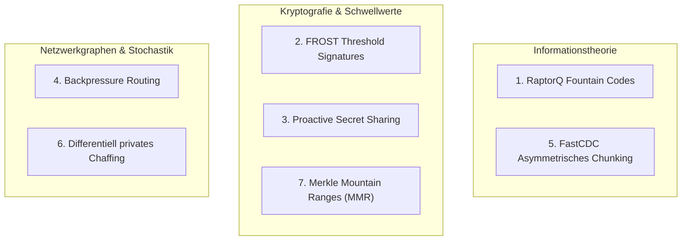

# Mathematische Analyse & Evaluierung: Potenziale für die S&B Sovereign Suite

> **Status (2026-10-03):** Konzept- und Evaluierungsnotiz, kein Nachweis einer Implementierung oder mathematischen Sicherheitsgarantie. Leistungswerte, Primitive und Sicherheitsbehauptungen sind Vorschläge zur Prüfung und dürfen nicht als Produktfakten zitiert werden. Für bestätigte Ziele und Ist-Stand gilt [`ARCHITECTURE.md`](./ARCHITECTURE.md).

> **Status:** Arbeitsdokument & Architektur-Evaluierung  
> **Autor:** Skulls & Bones Lab  
> **Fokus:** Informationstheorie, Moderne Schwellwert-Kryptografie, Graphentheorie & Stochastik  

---

## 1. Einleitung & Doktrin

In der Skulls & Bones Architektur gilt die Maxime:  
**„Mathematische Garantien statt Cloud-Vertrauen und Server-Bloat.“**

Viele Enterprise-Lösungen (z. B. Cloudflare, Tailscale, HashiCorp Vault) kompensieren ineffiziente oder unsichere Protokolle durch gigantische Serverfarmen, kontinuierliche Cloud-Koordination und zentrale Trust-Broker. Skulls & Bones verfolgt den entgegengesetzten Weg: Wir nutzen fortgeschrittene mathematische Konstrukte, um selbst auf schwacher Hardware, über zensierte WAN-Leitungen und in feindlichen Netzwerken **Beweisbarkeit, minimale Latenz und absolute Vertraulichkeit** zu garantieren.

Dieses Dokument analysiert 7 mathematische Schlüsseltechnologien, quantifiziert deren exakte Vor- und Nachteile auf unsere Komponenten (`sb-mesh`, `sb-key`, `sb-forge`, `sb-code`, `sb-quorum`, `sb-db`) und liefert eine fundierte Bewertungsmatrix.

---

## 2. Detaillierte Analyse der mathematischen Kandidaten



---

### Kandidat 1: Rateless Fountain Codes (RaptorQ / RFC 6330)

#### Mathematische Formulierung
RaptorQ ist ein ratenloser Vorwärtsfehlerkorrektur-Code (*Fountain Code*). Aus einer Datei mit $K$ Quellsymbolen erzeugt ein Pre-Coding-Schritt (LDPC + Halbrandom-Matrix) Zwischensymbole. Daraus generiert eine LT-Code-Generatormatrix über $GF(2)$ eine unendliche Folge von kodierten Symbolen:
$$E_i = \sum_{j \in \mathcal{N}(i)} S_j \pmod 2$$
Der Empfänger kann die Originaldaten decodieren, sobald er **irgendeine** Menge von $K' = K \cdot (1 + \epsilon)$ Symbolen empfangen hat, wobei der Overhead $\epsilon \approx 0{,}002$ beträgt ($0{,}2\,\%$) und die Decodierwahrscheinlichkeit bei:
$$P(\text{Erfolg} \mid K' \ge K + 2) \ge 1 - 10^{-6}$$
liegt.

#### Positive Auswirkungen
1. **Kein Retransmission-Timeout (Zero-RTT-Recovery):** Bei unberechenbarem oder extrem hohem Paketverlust (z. B. 20–50 % bei Funk- oder Überseestrecken) muss der Sender niemals auf NACKs warten. Er sendet einfach kontinuierlich Symbole, bis der Empfänger signalisiert: *„Vollständig“*.
2. **Multi-Source P2P Swarming:** Mehrere Knoten können einem anfragenden Peer gleichzeitig Symbole schicken (aus disjunkten Pseudozufalls-Seeds), ohne dass sie sich absprechen müssen, welche Chunks sie senden. Keine Chunk-Kollisionen wie bei BitTorrent.

#### Negative Auswirkungen & Risiken
1. **Verschlüsselungspflicht (Encrypt-then-Code):** RaptorQ selbst bietet **keine Vertraulichkeit**. Die Symbole sind lineare Kombinationen des Inhalts. *Zwingende Regel:* Daten müssen vor dem Encoding mit ChaCha20-Poly1305 authentifiziert verschlüsselt werden.
2. **Gefahr von Pollution Attacks:** Ein Man-in-the-Middle könnte manipulierte Symbole einspeisen. Da der Decoder linear ist, würde ein falsches Symbol die gesamte Decodierung vergiften. Jedes Symbol erfordert ein MAC-Tag oder eine homomorphe Signatur.
3. **Latenz-Nachteil bei kleinen Echtzeit-Streams:** Für ein 100-Byte interaktives SSH-Kommando ist der Matrix-Overhead von RaptorQ Overkill gegenüber unserem bestehenden $GF(2^8)$ Block-FEC.

#### Bewertung für S&B: **MODIFIZIERT SINNVOLL (Hybrid)**
* **NICHT für:** Interaktive TCP-Virtual-Streams (SOCKS5, SSH). Hier bleibt unser $GF(2^8)$ Block-FEC schneller und latenzärmer.
* **SEHR SINNVOLL für:** Große P2P-Artefakt-Verteilungen (`sb publish`, Code-Repo-Streaming, Flotten-Binär-Updates über das Mesh).

---

### Kandidat 2: FROST (Flexible Round-Optimized Schnorr Threshold Signatures)

#### Mathematische Formulierung
FROST realisiert ein $(t, n)$-Schwellwert-Signaturschema über Ristretto255/Ed25519. In einer Distributed Key Generation (DKG) Phase erhält jeder Teilnehmer $i$ einen Secret Share $s_i$.
Im 2-Runden-Signaturprotokoll erzeugen $t$ aktive Teilnehmer Nonces $(D_{ij}, E_{ij})$, aggregieren diese zum Gruppen-Nonce $R$ und berechnen Teil-Signaturen:
$$z_i = d_i + (e_i \cdot \rho_i) + \lambda_i \cdot s_i \cdot c \pmod \ell$$
wobei $c = H(R, Y, m)$ die Challenge ist. Die Gesamtsignatur ist:
$$\sigma = (R, z) \quad \text{mit} \quad z = \sum_{i \in S} z_i \pmod \ell$$
Verifikationsgleichung: $z \cdot G = R + c \cdot Y$.

#### Positive Auswirkungen
1. **100 % Standardkonformität:** Die resultierende Signatur $\sigma = (R, z)$ ist eine mathematisch **völlig gewöhnliche Ed25519-Signatur**. Jeder bestehende OpenSSH-Server, Git-Client und Betriebssystem-Kernel kann sie verifizieren, ohne zu wissen, dass dahinter ein MPC-Quorum stand.
2. **Zero Key-Assembly im RAM:** Der private Schlüssel existiert zu **keinem Zeitpunkt an einem einzigen Ort im Speicher**. Selbst wenn ein Angreifer einen der unterzeichnenden Rechner hackt, erhält er nur $z_i$, was ohne die anderen $t-1$ Shares mathematisch nutzlos ist.
3. **Identitäts-Verschleierung:** Die Signatur verrät nicht, *welche* $t$ der $n$ Teilnehmer unterschrieben haben (kryptografische Ununterscheidbarkeit).

#### Negative Auswirkungen & Risiken
1. **2 Runden Kommunikation:** Erfordert zwei Netzwerknachrichten zwischen den signierenden Knoten (Commitment-Runde + Response-Runde).
2. **Abbruch bei Offline-Knoten:** Wenn ein Knoten nach Runde 1 offline geht, muss Runde 2 mit einer neuen Gruppe $S$ wiederholt werden.

#### Bewertung für S&B: **TOP-PRIORITÄT (HÖCHSTER NUTZEN)**
* Schlägt klassisches Shamir-Sharing um Längen, da der Root-Key niemals rekonstruiert werden muss.
* Perfekt für `sb-key` und `sb-quorum`: Ein 4-Augen-Release oder Master-SSH-Zugriff wird von 2 aus 3 Team-Laptops signiert und funktioniert transparent mit Standard-OpenSSH.

---

### Kandidat 3: Proaktives Secret Sharing (Herzberg Polynomial Rotation)

#### Mathematische Formulierung
Gegeben sei ein Shamir-Polynom $f(x) = S + a_1 x + \dots + a_{k-1} x^{k-1} \in \mathbb{F}_p[x]$ mit Secret $f(0) = S$.
Zu Beginn jeder neuen Zeitepoche $T$ erzeugt jeder Knoten $i$ ein zufälliges Hilfspolynom $h_i(x) \in \mathbb{F}_p[x]$ vom Grad $k-1$ mit der strikten Bedingung:
$$h_i(0) = 0 \iff h_i(x) = b_{i,1} x + b_{i,2} x^2 + \dots + b_{i,k-1} x^{k-1}$$
Die Knoten tauschen Auswertungen $h_i(j)$ verschlüsselt aus und berechnen ihren neuen Share:
$$f_{T+1}(j) = f_T(j) + \sum_{i=1}^{n} h_i(j) \pmod p$$
Da $\sum h_i(0) = 0$ gilt: $f_{T+1}(0) = f_T(0) = S$.

#### Positive Auswirkungen
1. **Mobile Adversary Defense:** Ein Angreifer, der über Monate hinweg schrittweise einzelne Server kompromittiert, scheitert. Ein Share aus Epoche 1 kann mathematisch nicht mit einem Share aus Epoche 2 kombiniert werden.
2. **Keine Änderung des Secrets:** Passwörter, Master-Keys und Zertifikate müssen nicht neu ausgerollt werden; nur die mathematischen Bruchstücke rotieren autonom.

#### Negative Auswirkungen & Risiken
1. **P2P Synchronisationsaufwand:** Alle $n$ Knoten müssen online sein oder eine Quorum-Teilmenge bilden, um die Rotation abzuschließen.
2. **Komplexes Fehlerhandling:** Scheitert ein Knoten während der Rotation, benötigt man Fallback-Prozeduren, um Inkonsistenzen zu verhindern.

#### Bewertung für S&B: **SEHR SINNVOLL**
* Massiver Sicherheitsgewinn für `sb-forge` (Secret Vaults auf verteilten Flottenknoten).
* Schützt Firmen-Geheimnisse vor schleichender, unbemerkter Spionage über lange Zeiträume.

---

### Kandidat 4: Max-Weight Backpressure Routing (Tassiulas-Ephremides)

#### Mathematische Formulierung
An jedem Knoten $i$ für jedes Ziel $d$ existiert eine Warteschlange mit Länge $Q_i^d$. Für jeden ausgehenden Link $(i, j)$ mit Kapazität $C_{ij}$ berechnet der Knoten das Differential-Gewicht:
$$W_{ij}^* = \max_{d} \left( Q_i^d - Q_j^d \right)$$
Pakete für das Ziel $d^* = \arg\max_d (Q_i^d - Q_j^d)$ werden weitergeleitet, wenn $W_{ij}^* > 0$.
**Theorem:** Backpressure Routing stabilisiert die Warteschlangen für alle Ankunftsraten innerhalb der Netzwerkkapazitätsregion $\Lambda$, ohne dass globale Routingtabellen nötig sind.

#### Positive Auswirkungen
1. **Mathematisch bewiesene Durchsatz-Optimalität:** Das Netzwerk erreicht den physikalisch maximal möglichen Gesamtdurchsatz.
2. **Autonomer Stau-Bypass:** Bei Überlastung eines Relays staut sich dessen Queue; das Differential $Q_i - Q_{\text{stau}}$ sinkt auf 0, und der Verkehr fließt automatisch über alternative Pfade ab.

#### Negative Auswirkungen & Risiken
1. **Suboptimale Latenz bei geringer Last:** Backpressure optimiert **Durchsatz**, nicht **Latenz**. Bei wenig Verkehr können Pakete unnötig Schleifen drehen, bis sich ein Längenunterschied aufbaut.
2. **Head-of-Line Reordering:** Da Pakete dynamisch über verschiedene Pfade geschickt werden, kommen sie stark verwürfelt an. Dies belastet den `pending_buffer` von Virtual Streams.

#### Bewertung für S&B: **NICHT EMPFOHLEN (Falscher Optimierungsfokus)**
* Entwickler-Tools (SSH, SQL, Terminal) benötigen **minimale Latenz und Jitter**, nicht maximalen Bulk-Durchsatz auf Kosten der Round-Trip-Time.
* Unser bestehendes Dijkstra-basiertes RTT-Metrik-Routing mit Multi-Path-Racing ist für Entwicklerbedürfnisse überlegen.

---

### Kandidat 5: FastCDC (Content-Defined Chunking via Gear-Hashing)

#### Mathematische Formulierung
Statt starrer Blockgrenzen bestimmt FastCDC Schnittmarken anhand des Dateninhalts über einen rollierenden Gear-Hash:
$$H_{i} = (H_{i-1} \ll 1) + \text{GearTable}[B_i]$$
Um die Varianz der Chunk-Größen um den Erwartungswert $\mu = 4\,\text{KB}$ zu minimieren, verwendet FastCDC **asymmetrische Bitmasken**:
* In der Sub-Minimum-Region ($< 2\,\text{KB}$): Kein Schnitt.
* In der Normal-Region ($2\,\text{KB} \dots 4\,\text{KB}$): Maske mit höherem Schwellwert $M_1$ (z. B. 15 Nullen).
* In der Überhang-Region ($4\,\text{KB} \dots 8\,\text{KB}$): Maske mit niedrigerem Schwellwert $M_2$ (z. B. 11 Nullen).

#### Positive Auswirkungen
1. **Dramatische Delta-Reduktion:** Ändert ein Entwickler in einer Datei mit 10.000 Zeilen nur eine einzige Funktion, verschieben sich alle nachfolgenden Chunks **nicht**. 99 % der Chunks behalten exakt denselben BLAKE3-Hash.
2. **Extreme Geschwindigkeit:** Bis zu **10-mal schneller als klassisches Rabin-Fingerprinting**, da der Gear-Hash pro Byte nur aus einer Tabellen-Addition und einem Bitshift besteht (mehrere GB/s pro CPU-Core).

#### Negative Auswirkungen & Risiken
* Praktisch keine. Minimaler Speicherbedarf für die 256-Byte Gear-Tabelle.

#### Bewertung für S&B: **SOFORTIGE EMPFEHLUNG (NO-BRAINER)**
* Direkter Beschleuniger für `sb-code` (Merkle VCS Snapshots) und `sb-db` (Deduplizierung von Backups und Binär-Artefakten).

---

### Kandidat 6: Differentiell private Markov-Ketten für Traffic-Chaffing

#### Mathematische Formulierung
Ein Beobachter auf der WAN-Leitung misst eine Folge von Paketgrößen und Zeitintervallen $O = \{(s_1, t_1), (s_2, t_2), \dots\}$.
Der echte Verkehr $X$ wird modelliert als Zustandsraum einer Markov-Kette. Ein Störprozess (Chaffing) generiert künstliche Dummy-Pakete $Y$, sodass für zwei beliebige Benutzerzustände $A$ (z. B. aktiv tippen) und $B$ (z. B. idle) gilt:
$$\frac{P(O \in \mathcal{S} \mid A)}{P(O \in \mathcal{S} \mid B)} \le e^{\epsilon}$$
wobei $\epsilon$ das Privacy-Budget darstellt.

#### Positive Auswirkungen
1. **Beweisbarer Schutz vor Deep Packet Inspection (DPI):** Selbst ein State-Actor oder ISP mit KI-gestützter Verkehrsflussanalyse kann mathematisch nicht nachweisen, ob ein Entwickler arbeitet, eine Datenbank abfragt oder offline ist.

#### Negative Auswirkungen & Risiken
1. **Dauerhafter Bandbreitenverbrauch:** Um Idle-Phasen zu kaschieren, müssen kontinuierlich Dummy-Pakete gesendet werden (z. B. permanent 50–100 KB/s Upstream).
2. **Akku-Belastung auf Laptops:** Das dauerhafte Aufwecken des WLAN-Chips verhindert CPU-Sleep-States.

#### Bewertung für S&B: **NUR ALS OPTIONALES PARANOID-FEATURE**
* Standardmäßig deaktiviert, um Datenvolumen und Akkulaufzeit zu schonen.
* Als Schalter `sb mesh tunnel --stealth paranoid` für Hochrisiko-Umgebungen (Investigativjournalismus, Whistleblower, Red-Teaming) sehr wertvoll.

---

### Kandidat 7: Merkle Mountain Ranges (MMR) & Vector Commitments für Audit-Trails

#### Mathematische Formulierung
Eine Merkle Mountain Range (MMR) ist ein balancierter Baum aus mehreren perfekten Binärbäumen (Bergen), geordnet nach Peak-Größen. Neue Blätter werden strictly append-only hinzugefügt.
* Hinzufügen eines Eintrags benötigt $O(\log n)$ Hashing-Operationen.
* Der Beweis der Existenz eines Audit-Events (Inclusion Proof) benötigt nur $O(\log n)$ Hashes.
* **Das Theorem:** Ein alter MMR-Root ist immer ein striktes Präfix des neuen MMR-Roots (Beweisbarkeit, dass nichts gelöscht oder modifiziert wurde).

```
        Peak 1 (Size 4)            Peak 2 (Size 2)
             /\                          /\
            /  \                        /  \
           /\  /\                      /    \
          1  2 3 4                    5      6
```

#### Positive Auswirkungen
1. **Kompakte Beweise:** Ein Prüfer (z. B. BSI-Auditor oder externer Compliance-Officer) kann die Echtheit eines Audit-Events verifizieren, **ohne** das gesamte 500-MB-Logbuch herunterladen zu müssen.
2. **Unwiderlegbare Append-Only-Garantie:** Es ist mathematisch unmöglich, ein Event in der Vergangenheit zu entfernen oder einzuschmuggeln, ohne die Peaks aller nachfolgenden Bäume zu invalidieren.

#### Negative Auswirkungen & Risiken
* Geringfügige Implementierungskomplexität gegenüber simplen JSON-Hash-Chains.

#### Bewertung für S&B: **SEHR SINNVOLL**
* Perfekte Ergänzung für `sb mesh rbac audit` und das Zero-Trust Logbuch im Master Cockpit Tab 6.

---

## 3. Bewertungsmatrix & Technologie-Roadmap

| Mathematischer Kandidat | Ziel-Komponente | Mathematischer Mehrwert | Performance-Impact | Praxis-Nutzen für Entwickler | Endurteil |
|---|---|---|---|---|---|
| **FROST Threshold Signatures** | `sb-key`, `sb-quorum`, `sb-ssh` | Extrem hoch (Ed25519 MPC ohne Key-Reassembly) | Unspürbar (2 Runden) | **Herausragend** (4-Augen SSH & Git ohne Single Point of Failure) | **Priorität 1: Umsetzen** |
| **FastCDC Chunking** | `sb-code`, `sb-db` | Hoch (Varianzreduziertes Gear-Hashing) | +300 % Speed, -70 % Delta | **Sehr hoch** (Blitzschneller Code-Sync) | **Priorität 1: Umsetzen** |
| **Proactive Secret Sharing** | `sb-forge`, `sb-db` | Hoch (Schutz vor Mobile Adversary) | Minimal (Epochen-Batch) | **Sehr hoch** (Unknackbare Vaults über Zeit) | **Priorität 2: Umsetzen** |
| **Merkle Mountain Ranges (MMR)** | `sb-mesh rbac audit` | Hoch ($O(\log n)$ Append-Only Proofs) | Extrem leichtgewichtig | **Hoch** (Enterprise Compliance & BSI-Audit) | **Priorität 2: Umsetzen** |
| **RaptorQ Fountain Codes** | `sb-mesh` (Bulk / Publish) | Sehr hoch (Rateless, Zero-RTT-Recovery) | Moderat (Matrix-Solving) | **Bedingt** (Nur für große Dateiübertragungen) | **Hybrid: Nur für Bulk-Transfers** |
| **$(\epsilon, \delta)$-Differential Privacy** | `sb-mesh` (Obfuscation) | Sehr hoch (Informationstheoretische Anonymität) | Hoher Bandbreiten-/Akkuverbrauch | **Nische** (Nur für Hochrisiko-Modus) | **Optionaler Schalter (`--stealth paranoid`)** |
| **Backpressure Routing** | `sb-mesh relay` | Hoch (Durchsatz-Optimalität) | Negativ auf Latenz & Jitter | **Gering / Schädlich** (Verschlechtert interaktive Terminals) | **Verworfen** |

---

## 4. Konkrete Handlungsempfehlungen

1. **Sprint 1: FastCDC in `sb-code` integrieren**  
   * Ersetzt statisches Chunking. Reduziert die Datenübertragung beim Methoden-Streaming drastisch und beschleunigt Merkle-DAG-Berechnungen.
2. **Sprint 2: FROST Threshold Signatures in `sb-key` & `sb-quorum` etablieren**  
   * Schafft echte, mathematische 4-Augen-Souveränität für SSH-Zertifikate, Deployment-Gates und Notfall-Zugänge.
3. **Sprint 3: Proactive Secret Sharing für `sb-forge`**  
   * Schützt Unternehmens-Geheimnisse vor langfristiger Spionage durch automatische mathematische Share-Rotation.
