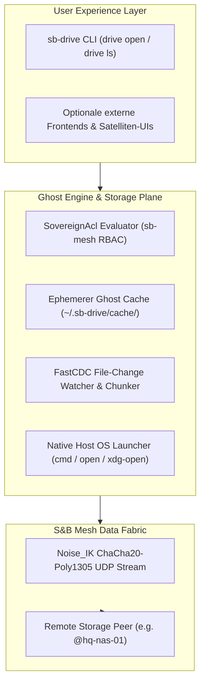

# `sb-drive` — Sovereign Peer-Shared Mesh Storage & Ghost Launch Engine

> **Dokument-ID:** `SBM-TOOL-SB-DRIVE`  
> **Status:** In Entwicklung (`tools/sb-drive`)  
> **Doktrin:** Zero-Cloud • Peer-to-Peer • NTFS-inspirierte ACLs • FastCDC Delta-Sync • Ghost Mount & Native Launch

---

## 🏛️ Was ist `sb-drive`?

`sb-drive` ist das **kryptographisch gesicherte, Peer-Shared Distributed Filesystem** des Skulls & Bones Ökosystems. Es ersetzt traditionelle Windows-Dateiserver (SMB/CIFS), Nextcloud und Google Drive durch eine **100% dezentrale, souveräne Speicherarchitektur**.

### Das Kern-Prinzip:
- **Kein blindes dezentrales IPFS:** Daten liegen nicht unkontrolliert auf fremden Knoten, sondern verbleiben autoritativ auf den physischen Festplatten der jeweiligen Besitzer-Maschinen (z. B. `@finance-nas` oder `@alice-workstation`).
- **NTFS-inspirierte ACLs (`SovereignAcl`):** Jede Datei und jeder Ordner wird durch granulare Berechtigungslisten (`Read`, `Write`, `Execute`, `Delete`, `TakeOwnership`) mit explizitem *Deny-over-Allow* geschützt.
- **Ghost Mount & Native Launch:** Öffnet der Anwender eine Datei im Mesh, wird sie ephemer in einen verschlüsselten RAM-/Dateicache gestreamt und mit der auf dem Host installierten Standardanwendung (Microsoft Word, Excel, VS Code, GIMP, Preview) gestartet.
- **FastCDC Delta Sync:** Beim Speichern errechnet ein lokaler Watcher per Gear-Hash nur die modifizierten Chunks und repliziert sie in Millisekunden über den ChaCha20-Poly1305 Noise_IK Mesh-Kanal zurück zum Host.

---

## 🏗️ Architektur-Schichten

---

## 📋 Meilensteine & Phasen

### Phase 1: Ghost Launch & Local Cache Engine
- [x] Crate-Initialisierung `tools/sb-drive` im Workspace.
- [ ] Datenstrukturen: `DriveShare`, `RemoteFileMeta`, `GhostHandle`.
- [ ] Native OS App Launcher (Windows `cmd.exe /c start`, macOS `open`, Linux `xdg-open`).
- [ ] Ephemerer Cache-Manager mit SHA256-Integritätsprüfung.

### Phase 2: FastCDC Delta Sync Watcher
- [ ] File-Modification-Watcher für geöffnete Dokumente.
- [ ] Zerlegung geänderter Dateien in FastCDC Chunks ($M_S, M_L$ Gear Matrix).
- [ ] Delta-Push zurück an den autoritativen Host ohne Vollsperre.

### Phase 3: NTFS ACL Enforcement & Multi-Host Directory
- [ ] Integration mit `sb_mesh::rbac::SovereignAcl`.
- [ ] Virtual Multi-Host Filesystem Registry: Akkumulation aller im Mesh freigegebenen Shares.
- [ ] CLI-Befehle in `sb-drive`: `drive ls @peer:/path`, `drive open @peer:/path`.

### Phase 4: Client & Explorer UI Integration (Externer Satellit)
- [ ] Bereitstellung von IPC/API-Endpunkten für optionale Desktop-Explorer-Frontends.
- [ ] Drag & Drop von lokalen Dateien ins Mesh mit automatischer ACL-Vererbung über Client-Integration.
